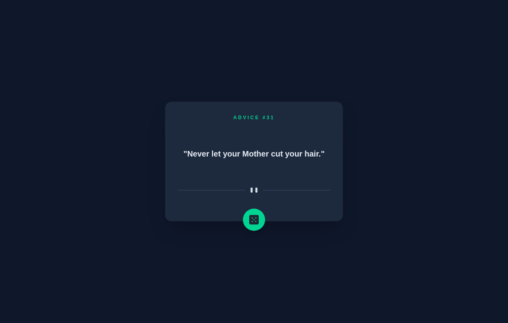

<div align="center">


#Live Demo : [click](https://random-advice-1xzc.vercel.app/)
# Random Advice Generator
A clean, responsive web app that serves a fresh piece of advice at the roll of a dice.

[](https://react.dev)
[](https://www.typescriptlang.org)
[](https://vite.dev)
[](https://tailwindcss.com)



</div>

---

## Table of Contents

- [Overview](#overview)
- [Features](#features)
- [Tech Stack](#tech-stack)
- [Getting Started](#getting-started)
- [Available Scripts](#available-scripts)
- [Project Structure](#project-structure)
- [How It Works](#how-it-works)
- [API](#api)
- [Contributing](#contributing)
- [Author](#author)

## Overview

**Random Advice Generator** fetches a random piece of advice from the free [Advice Slip API](https://api.adviceslip.com) and displays it in a minimal, dark-themed card. Click the dice button to get a new one.

## Features

- **Random advice on demand** – a new advice slip with every click of the dice button.
- **Auto-load on start** – the first advice is fetched as soon as the page opens.
- **Loading state** – animated spinner (and spinning dice) while a request is in flight.
- **Error handling** – friendly error message if the API request fails.
- **No stale responses** – a cache-busting timestamp is added to each request so you always get fresh advice.
- **Responsive design** – separate desktop and mobile divider artwork, works on any screen size.
- **Type-safe** – written in TypeScript with a typed API response model.
- **Accessible** – labelled action button and descriptive image alt text.

## Tech Stack

| Category   | Technology                                                         |
| ---------- | ------------------------------------------------------------------ |
| UI Library | [React 19](https://react.dev)                                      |
| Language   | [TypeScript](https://www.typescriptlang.org)                       |
| Build Tool | [Vite](https://vite.dev)                                           |
| Styling    | [Tailwind CSS v4](https://tailwindcss.com) (via `@tailwindcss/vite`) |
| Linting    | [ESLint](https://eslint.org) + `typescript-eslint`                 |
| Data       | [Advice Slip JSON API](https://api.adviceslip.com)                 |

## Getting Started

### Prerequisites

- [Node.js](https://nodejs.org) 20.19+ or 22.12+ (required by Vite)
- npm (comes with Node.js)

### Installation

```bash
# 1. Clone the repository
git clone https://github.com/darksnake288-pixel/Random-Advice.git

# 2. Move into the project folder
cd Random-Advice

# 3. Install dependencies
npm install

# 4. Start the development server
npm run dev
```

Then open [http://localhost:5173](http://localhost:5173) in your browser.

## Available Scripts

| Command           | Description                                         |
| ----------------- | --------------------------------------------------- |
| `npm run dev`     | Start the Vite development server with hot reload   |
| `npm run build`   | Type-check with `tsc` and build for production      |
| `npm run preview` | Preview the production build locally                |
| `npm run lint`    | Run ESLint on the project                           |

## Project Structure

```
Random-Advice/
├── public/
│   ├── favicon.svg
│   └── icons.svg
├── src/
│   ├── assets/
│   │   ├── icon-dice.svg               # Dice button icon
│   │   ├── grid.svg                    # Loading spinner
│   │   ├── pattern-divider-desktop.svg # Divider (desktop)
│   │   └── pattern-divider-mobile.svg  # Divider (mobile)
│   ├── App.tsx                         # Main component & fetch logic
│   ├── index.css                       # Tailwind CSS entry
│   └── main.tsx                        # React entry point
├── index.html
├── vite.config.ts
├── eslint.config.js
├── tsconfig*.json
└── package.json
```

## How It Works

1. When `App` mounts, a `useEffect` calls `getAdvice()`.
2. `getAdvice()` sets the loading state and requests `https://api.adviceslip.com/advice?t=<timestamp>`.
3. The JSON response is typed as `AdviceResponse` and stored in state.
4. The card renders the advice ID and text, a spinner while loading, or an error message on failure.
5. Clicking the dice button calls `getAdvice()` again (the button is disabled while loading).

## API

This project uses the public **[Advice Slip JSON API](https://api.adviceslip.com)** – no API key required.

**Endpoint**

```
GET https://api.adviceslip.com/advice
```

**Example response**

```json
{
  "slip": {
    "id": 183,
    "advice": "Always get two ciders."
  }
}
```

> **Note:** the API caches responses for about 2 seconds, so clicking very quickly may return the same advice.

## Contributing

Contributions, issues and feature requests are welcome!

1. Fork the project
2. Create your feature branch: `git checkout -b feature/amazing-feature`
3. Commit your changes: `git commit -m "Add amazing feature"`
4. Push to the branch: `git push origin feature/amazing-feature`
5. Open a Pull Request

## Author

**Youssef** – [@darksnake288-pixel](https://github.com/darksnake288-pixel)

If you like this project, please give it a star on GitHub!
